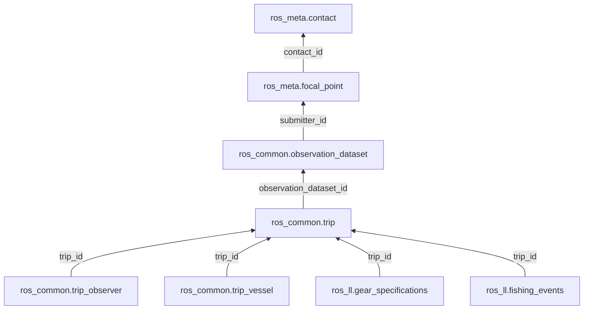

## Purpose

Map each ROS LL worksheet to database records and dependencies before deciding ObServe source coverage.

Start with META as the import entry point; detailed metadata input rules remain a separate review.

This review gives structural answers for empty sheets and distinguishes them from import-application behaviour.

## Evidence and limits

The workbook contract is `ros.form.model/inst/models/4.2.0/ll-form.yaml`.

ROS database **4.0.0** is the agreed authority, represented here by `ros-schema-atlas/models/4.0.0/`.

Database 4.0.0 and form 4.2.0 have independent version numbering; their different numbers are expected.

Its CSV files describe columns, NOT NULL flags, primary keys and foreign keys, but omit defaults and CHECK constraints.

They also do not establish all unique constraints, triggers or import-service behaviour.

Other schema copies and historical output mappings are excluded from this analysis.

The remaining questions concern destinations and import behaviour, not the choice of database version.

## Reading the requirements

* A required form field must be supplied when a data row is reported, subject to the agreed validation contract.
* A database NOT NULL flag constrains a row that exists; it does not create a requirement to insert that row.
* A child FK requires a valid parent when populated; it does not require every parent to have a child.
* A worksheet can be structurally present with no data rows. This differs from deleting the worksheet.
* Workbook identifiers identify reported entities; database technical IDs must be resolved separately.

The 4.2.0 model declares parent keys and field requirements, but no explicit per-sheet minimum row count.

This observation alone does not prove that the importer accepts empty sheets.

Actual import behaviour remains to be checked against the importer used with ROS database 4.0.0.

## Shared records and dependencies

Several sheets populate the same record; a worksheet is not necessarily a database table.

O-INFO, V-INFO, V-TRIP and V-ATTRIBUTES all contribute to one `ros_common.trip_vessel` row keyed by trip ID.

The diagram shows FK direction, from the referencing record to the required parent.

Additional nullable links attach tori-line, setting, hauling, mitigation and specimen-detail records.

The per-sheet sections below give their direction; worksheet order is not necessarily database insertion order.

## Can each sheet be left empty? {#empty-sheets}

Here, empty means the worksheet is present with no data rows; META instead has unfilled metadata cells.

The answers use the recorded ROS 4.0.0 PK, FK and NOT NULL constraints.

Conditions concerning workbook parent rows come from the independent 4.2.0 form model and are identified below.

META and O-INFO are entry points for this per-trip import, not claims that SQL requires every table to be nonempty.

For all other sheets, no listed database constraint requires a row solely because its trip exists.

**Yes** means the destination can omit those details while retaining any parent or shared records needed elsewhere.

These answers follow the supplied schema metadata; live triggers and import-application behaviour were not checked.

| Sheet                       | Can it be empty?                        | Reason or condition                                                                               |
| --------------------------- | --------------------------------------- | ------------------------------------------------------------------------------------------------- |
| META                        | No for a new dataset                    | Dataset creation needs reporting metadata; supplying it outside META is a separate input route.   |
| O-INFO                      | No for this trip export                 | The trip is the workbook root; reported child rows need its O-INFO identity.                      |
| V-INFO                      | Yes, structurally                       | No required vessel FK or separate V-INFO row; other sheets may populate trip_vessel.              |
| V-TRIP                      | Yes                                     | Departure/return values are nullable columns of the shared trip_vessel record.                    |
| V-ATTRIBUTES                | Yes                                     | The shared vessel record needs no attribute placeholder or empty attribute associations.          |
| G-GENERAL                   | Yes, with a parent record if needed     | Configurations and device associations still need a gear_specifications parent.                   |
| G-CONFIG-BRANCHLINES        | Yes                                     | No recorded constraint requires a gear record to have configurations, sections or storage rows.   |
| G-CONFIG-MITIGATION-DEVICES | Yes                                     | The tori-line FK is nullable; no device-association row is required for every gear record.        |
| E-SET                       | Yes, if all descendant sheets are empty | No event is required by the trip FK; reported descendants require an E-SET parent in the form.    |
| E-SET-LIGHTS                | Yes                                     | A setting operation is not required to have light rows.                                           |
| E-SET-MITIGATION-MEASURES   | Yes                                     | The event-to-mitigation FK is nullable; device associations are not required for every measure.   |
| E-SET-HOOKS                 | Yes                                     | A setting operation is not required to have hook-detail rows.                                     |
| E-SET-BAITS                 | Yes                                     | A setting operation is not required to have bait-detail rows.                                     |
| E-SET-HAULING               | Yes, if biteoff rows are absent         | The event FK is nullable; reported biteoffs require a hauling parent and its form row.            |
| E-SET-HAULING-BITEOFFS      | Yes                                     | A hauling operation is not required to have biteoff-detail rows.                                  |
| E-SET-CATCHES               | Yes, if specimen descendants are absent | The event needs no catch child; specimen rows require a parent catch in the form.                 |
| E-SET-CATCH-SPECIMENS       | Yes, if SSI and tag sheets are empty    | A catch needs no specimen child; SSI/tag rows require a parent specimen in the form.              |
| E-SET-CATCH-SPECIMENS-SSI   | Yes                                     | The specimen detail FKs are nullable; depredation reported on the main specimen sheet can remain. |
| E-SET-TAG-DETAILS           | Yes                                     | The specimen-to-tag FK is nullable; no empty tag record is required.                              |

V-INFO is a useful distinction: its fields are mandatory on a reported row, but its DB link remains nullable.

This does not establish that a vessel-free report meets the CTOI's reporting requirements.

G-GENERAL may contribute no equipment data while a gear parent is still needed by another sheet's child records.

An empty G-CONFIG-MITIGATION-DEVICES sheet does not require an ID-only row or a blank tori-line record.

An empty V-ATTRIBUTES sheet adds no separate database record; the shared vessel row can come from other sheets.

## Sheet destinations

The table destinations support the empty-sheet answers; unresolved field destinations are identified per sheet.

The mandatory count comes from the 4.2.0 form, independently of database nullability.

| Sheet                       | Mandatory fields | Main destination(s)                                    |
| --------------------------- | ---------------- | ------------------------------------------------------ |
| META                        | 11               | ros_common.observation_dataset                         |
| O-INFO                      | 4                | ros_common.trip / trip_observer / trip_vessel          |
| V-INFO                      | 9                | ros_common.trip_vessel; ros_meta registries            |
| V-TRIP                      | 1                | ros_common.trip_vessel                                 |
| V-ATTRIBUTES                | 1                | ros_common.trip_vessel + attribute children            |
| G-GENERAL                   | 4                | ros_ll.gear_specifications                             |
| G-CONFIG-BRANCHLINES        | 1                | ros_ll.branchline_configurations / branchline_sections |
| G-CONFIG-MITIGATION-DEVICES | 6                | ros_ll.tori_line_details + device associations         |
| E-SET                       | 19               | ros_ll.fishing_events / setting_operations + children  |
| E-SET-LIGHTS                | 5                | ros_ll.lights_by_type_and_colour                       |
| E-SET-MITIGATION-MEASURES   | 12               | ros_ll.mitigation_measures + device associations       |
| E-SET-HOOKS                 | 3                | ros_ll.hooks_by_type                                   |
| E-SET-BAITS                 | 5                | ros_ll.baits_by_conditions                             |
| E-SET-HAULING               | 12               | ros_ll.hauling_operations + offal positions            |
| E-SET-HAULING-BITEOFFS      | 2                | ros_ll.biteoffs_by_branchlines_set                     |
| E-SET-CATCHES               | 8                | ros_ll.catch_details                                   |
| E-SET-CATCH-SPECIMENS       | 9                | ros_ll.specimens; ros_common.biometric_information     |
| E-SET-CATCH-SPECIMENS-SSI   | 8                | SSI + non-target condition + depredation details       |
| E-SET-TAG-DETAILS           | 4                | ros_ll.tag_details; ros_meta.contact                   |

### META {#meta}

**Can this sheet be empty? No for a new dataset.**

Dataset creation needs reporting metadata; supplying it outside META is a separate input route.

The entry point is `ros_common.observation_dataset` in the saved database metadata.

Its `submitter_id` references `ros_meta.focal_point.contact_id`, which references `ros_meta.contact.id`.

Resolve the reporting contact and reference codes before creating the dataset; then attach trips to its technical ID.

META provides reporting metadata, but it does not provide all mandatory database columns by itself.

The dataset also requires vessel type, creation time, originator/version, model/code-list versions, source and status.

It also requires `complete`, reporting country and a submitter; technical ID generation must be confirmed.

The form revision must not silently become the database model version: they identify different contracts.

Reporting year and entity have no identified columns in this 4.0.0 dataset table; their destinations remain open.

User-supplied metadata remains agreed. Detailed META field rules remain open.

#### Per-trip imports and optional dataset consolidation

The agreed workflow is one trip, one Excel workbook, one submission and one new observation dataset.

Optional later consolidation is a separate maintenance operation, not a requirement of the per-trip exporter.

The proposed marker uses the dataset status; `NEW` is an example, not yet a validated application status.

The schema exposes a required text status field; check its application semantics before choosing the marker.

A future script could select marked datasets and group those with matching submission metadata.

Define the comparison fields explicitly: technical IDs and creation timestamps cannot be equality keys.

For each group, retain one dataset and reattach its trips; their dependent records remain linked to the same trips.

Preserve provenance and reconcile lifecycle metadata before removing any redundant dataset records.

This records an implementation option only. No consolidation script or database change is requested at this stage.

### O-INFO {#o-info}

**Can this sheet be empty? No for this trip export.**

The trip is the workbook root; reported child rows need its O-INFO identity.

Create or resolve `ros_common.trip` with its dataset link, original trip ID and technical `uid`.

`trip.observation_dataset_id` is NOT NULL and references `observation_dataset.id`.

Observer details belong to `ros_common.trip_observer`; resolve `ros_meta.observer` before linking its `contact_id`.

`trip_observer.trip_id` is its primary key and FK; `observer_id` is also NOT NULL.

Thus there is at most one observer row per trip in this snapshot; a trip-ID-only observer row is insufficient.

Trip summaries belong to the shared `ros_common.trip_vessel` row, keyed by `trip_id`.

Lost-day reasons belong to `ros_common.trip_reasons_for_days_lost`, whose `trip_id` is NOT NULL.

Neither child FK proves that every trip must have an observer, vessel summary or reason row.

The form nevertheless requires observer ID and two set counts on each O-INFO row; retain these requirements.

### V-INFO {#v-info}

**Can this sheet be empty? Yes, structurally.**

No required vessel FK or separate V-INFO row; other sheets may populate trip_vessel.

Resolve the vessel in `ros_meta.vessel` and link it through `ros_common.trip_vessel.vessel_id`.

Resolve captain and fishing-master identities in `ros_meta.contact`; link `skipper_id` and `fishing_master_id`.

Vessel identity, flag and main gear are registry attributes; crew count belongs to `trip_vessel`.

Use the same trip row as O-INFO, V-TRIP and V-ATTRIBUTES. These sheets do not each create a separate vessel row.

Only `trip_id` is NOT NULL in the saved `trip_vessel` table; this does not relax the nine mandatory form fields.

Registry matching and any permitted registry update are separate decisions; this review authorizes no updates.

### V-TRIP {#v-trip}

**Can this sheet be empty? Yes.**

Departure/return values are nullable columns of the shared trip_vessel record.

Departure/return dates, countries, ports and coordinates belong to `ros_common.trip_vessel`.

They enrich the row already shared with O-INFO and V-INFO, through its primary key `trip_id`.

The location columns are embedded in this table; these details do not require a separate location entity.

All these detail columns are nullable in the snapshot; no extra location row is required by its listed FKs.

The database permits omission of these details. Import-application handling is a separate check.

The agreed export times remain 00:00 for departure and 23:59 for return.

### V-ATTRIBUTES {#v-attributes}

**Can this sheet be empty? Yes.**

The shared vessel record needs no attribute placeholder or empty attribute associations.

Dimensions and electronics enrich the same `ros_common.trip_vessel` row as V-INFO and V-TRIP.

Further destinations are `ros_common.trip_vessel_main_engines` and `ros_common.trip_waste_managements`.

Preservation and storage use `ros_common.trip_vessel_fish_preservation_method` and `trip_vessel_fish_storage_type`.

These child tables link to `ros_common.trip.id`; their FKs do not require the trip to have children.

An engine row requires power value and unit; preservation/storage association rows require their reference code.

A bare trip ID cannot create those engine or code-association rows under the recorded NOT NULL constraints.

The shared vessel row may already exist from other sheets, so database structure alone does not require a placeholder.

Keep optional attributes empty and consolidate from RAV later, as agreed. No ID-only row is needed by the DB.

### G-GENERAL {#g-general}

**Can this sheet be empty? Yes, with a parent record if needed.**

Configurations and device associations still need a gear_specifications parent.

Equipment indicators belong to `ros_ll.gear_specifications`, with a NOT NULL FK `trip_id` to `ros_common.trip`.

Its PK is `id`, not `trip_id`; the exported PK/FK metadata alone does not prove one gear record per trip.

Branchline configurations and trip-level mitigation devices refer to this gear record.

Resolve a shared gear record when importing those details, even if G-GENERAL has no useful equipment values.

The database needs the gear parent for those children, not a G-GENERAL worksheet row containing equipment flags.

The 4.0.0 metadata stores nullable booleans; how the importer represents NAV/UNK remains to be established.

The three equipment responses are mandatory in the form; their sources and missing-data rules remain open.

### G-CONFIG-BRANCHLINES {#g-config-branchlines}

**Can this sheet be empty? Yes.**

No recorded constraint requires a gear record to have configurations, sections or storage rows.

Configurations belong to `ros_ll.branchline_configurations`; `gear_specification_id` is NOT NULL.

Sections belong to `ros_ll.branchline_sections`; `branchline_configuration_id` is NOT NULL.

Storage uses `ros_ll.branchline_configurations_storage`, requiring both the configuration ID and storage code.

The chain is trip, gear specification, configuration, then any sections and storage associations.

The recorded FKs do not require a configuration to have a section or a storage row.

SQL allows nullable section details; this does not establish a reason to create empty sections.

The form uses string configuration/section IDs; the snapshot has integer numbers. Translation remains open.

The form's unique key omits section ID; review how multiple sections of one configuration should be represented.

The two-ID export remains a working hypothesis. Source existence, population and granularity need Pascal's review.

### G-CONFIG-MITIGATION-DEVICES {#g-config-mitigation-devices}

**Can this sheet be empty? Yes.**

The tori-line FK is nullable; no device-association row is required for every gear record.

Tori-line measurements belong to `ros_ll.tori_line_details`.

The link is `ros_ll.gear_specifications.tori_line_detail_id -> ros_ll.tori_line_details.id` and is nullable.

Other device codes belong to `ros_ll.gear_specifications_mitigation_device`, requiring gear ID and device code.

The saved FK therefore does not force a gear record to have tori-line details or device-association rows.

If details are reported, create them before setting that FK, or attach them in a later update.

The five mandatory tori-line measurements/types in the form are nullable database columns in the snapshot.

A trip-ID-only form row would miss those five fields; database nullability does not make that row valid.

The sketch-in-trip-report field has no identified destination. The database permits an absent tori-line link.

### E-SET {#e-set}

**Can this sheet be empty? Yes, if all descendant sheets are empty.**

No event is required by the trip FK; reported descendants require an E-SET parent in the form.

Set identity belongs to `ros_ll.fishing_events`; `trip_id` is a NOT NULL FK to `ros_common.trip`.

Setting details belong to `ros_ll.setting_operations`, referenced by nullable `fishing_events.setting_operation_id`.

Create reported operation details before linking the event, or fill that nullable link afterwards.

Leader details use `ros_ll.leader_set`; float lengths use `ros_ll.floatlines`.

Targets use `ros_ll.setting_operations_target_species`; each of these tables requires `setting_operation_id`.

A leader row also requires material, percentage, minimum/maximum length values and both units.

A target association requires a species code; the FKs do not force every setting to have either kind of child.

Leader fields in E-SET populate a separate database child table; they do not belong to the event row itself.

No destination for `mainline_material` is identified in the snapshot. Nineteen form fields remain mandatory.

The form's trip/set key must resolve to a technical event ID for downstream sheets; its construction remains open.

### E-SET-LIGHTS {#e-set-lights}

**Can this sheet be empty? Yes.**

A setting operation is not required to have light rows.

Light rows belong to `ros_ll.lights_by_type_and_colour`, with a NOT NULL FK to `setting_operations.id`.

Resolve the setting operation through the trip/set event before adding light details.

Type, colour, count and percentage are nullable in the snapshot, but the form requires all five of its fields.

The database permits a setting without light rows. Import-application handling is a separate check.

### E-SET-MITIGATION-MEASURES {#e-set-mitigation-measures}

**Can this sheet be empty? Yes.**

The event-to-mitigation FK is nullable; device associations are not required for every measure.

Set-level measures belong to `ros_ll.mitigation_measures`.

`fishing_events.mitigation_measure_id` is a nullable FK to that table.

Other device codes use `ros_ll.mitigation_measures_mitigation_devices`, requiring measure ID and device code.

Resolve the event, create any reported measure record, and attach its ID; code associations follow that record.

The snapshot does not force every event to have a measure record or every measure to have device associations.

The database permits omission of the measure record; a reported form row still has twelve mandatory fields.

### E-SET-HOOKS {#e-set-hooks}

**Can this sheet be empty? Yes.**

A setting operation is not required to have hook-detail rows.

Hook details belong to `ros_ll.hooks_by_type`, requiring `setting_operation_id`.

Resolve the setting through the event; then add type, percentage and variations for each reported hook row.

The FK does not require a setting to have hook rows; the form requires trip ID, set ID and hook/device type.

The snapshot references `refs_fishery.hook_types`; the form uses `refs_fishery.hook_and_terminal_devices`.

Confirm the target reference and code conversion before declaring this a direct database mapping.

### E-SET-BAITS {#e-set-baits}

**Can this sheet be empty? Yes.**

A setting operation is not required to have bait-detail rows.

Bait details belong to `ros_ll.baits_by_conditions`, requiring `setting_operation_id`.

Condition, species, ratio and dye colour correspond to the reported bait attributes.

The snapshot references general species; the form uses the bait-species list. Confirm compatible code values.

The FK does not require every setting to have bait rows; an ID-only form row misses three mandatory bait fields.

### E-SET-HAULING {#e-set-hauling}

**Can this sheet be empty? Yes, if biteoff rows are absent.**

The event FK is nullable; reported biteoffs require a hauling parent and its form row.

Hauling details belong to `ros_ll.hauling_operations`.

`fishing_events.hauling_operation_id` is a nullable FK to the hauling record.

Offal-disposal positions use `ros_ll.hauling_offal_disposal_positions`, requiring hauling ID and position.

Create reported hauling details, attach the ID to the event, then attach any offal-position and biteoff rows.

The nullable event FK does not force a hauling row for every set in this metadata.

The form requires twelve fields on a reported hauling row; omit its details only when no biteoff row needs it.

### E-SET-HAULING-BITEOFFS {#e-set-hauling-biteoffs}

**Can this sheet be empty? Yes.**

A hauling operation is not required to have biteoff-detail rows.

Biteoff details belong to `ros_ll.biteoffs_by_branchlines_set`, requiring `hauling_operation_id`.

Resolve the event's hauling record before adding a biteoff detail.

Configuration number and biteoff count are nullable; no FK to `branchline_configurations` is recorded.

The form uses a string configuration ID, while this snapshot uses an integer number; agree correspondence.

Only trip/set IDs are mandatory in the form; an ID-only row raises its at-least-one-detail warning.

The FK does not force a hauling record to have biteoff details; absence of a row must not be read as zero biteoffs.

### E-SET-CATCHES {#e-set-catches}

**Can this sheet be empty? Yes, if specimen descendants are absent.**

The event needs no catch child; specimen rows require a parent catch in the form.

Catch rows belong to `ros_ll.catch_details`, with mandatory `catch_detail_original_id`.

Its `fishing_event_id` FK is nullable in the database snapshot.

The form still requires the parent E-SET key. Resolve the event and link reported catches to it.

The database's nullable FK is not permission to export unlinked catches under the form contract.

Species, fate and weight fields are stored here; weight values and units are embedded columns.

Resolve fate type and fate together: the database uses a composite reference FK.

No child FK proves that every event must have a catch. Zero catch and unavailable catch data need separate rules.

### E-SET-CATCH-SPECIMENS {#e-set-catch-specimens}

**Can this sheet be empty? Yes, if SSI and tag sheets are empty.**

A catch needs no specimen child; SSI/tag rows require a parent specimen in the form.

Specimen identity belongs to `ros_ll.specimens`, requiring `specimen_original_id`.

Measurements, sex, maturity and collected samples belong to `ros_common.biometric_information`.

Sampling period is stored on the specimen; its catch and biometric FKs are nullable in the database snapshot.

The form requires a parent catch. Resolve it, create reported biometric details, then attach them to the specimen.

Depredation can come from this sheet or SSI. Other nullable links attach SSI, non-target conditions and tag details.

The recorded FKs do not require every catch to have specimens or every specimen to have biometric details.

Nine form fields remain mandatory for a reported specimen; SQL nullability does not relax those requirements.

### E-SET-CATCH-SPECIMENS-SSI {#e-set-catch-specimens-ssi}

**Can this sheet be empty? Yes.**

The specimen detail FKs are nullable; depredation reported on the main specimen sheet can remain.

Specific interaction details belong to `ros_ll.additional_catch_details_on_ssi`.

Capture/release conditions belong to `ros_common.additional_details_on_non_target_species`.

Depredation belongs to `ros_common.depredation_details`.

All three are linked by nullable FK columns on `ros_ll.specimens`; they do not contain a specimen FK themselves.

Create any reported detail records and attach their technical IDs to the already resolved specimen.

No listed FK requires every specimen to have these details; eight form fields are required on a reported SSI row.

`hook_type` has no identified column in the 4.0.0 SSI table. Confirm its destination.

Condition and depredation reference names also differ between the saved schema and current form.

### E-SET-TAG-DETAILS {#e-set-tag-details}

**Can this sheet be empty? Yes.**

The specimen-to-tag FK is nullable; no empty tag record is required.

Tag details belong to `ros_ll.tag_details`, linked by nullable `ros_ll.specimens.tag_detail_id`.

`tag_finder_id` is a nullable FK to `ros_meta.contact`; resolve the finder if supplied and matchable.

Create reported tag details and attach their ID to the specimen; do not create a separate specimen for this sheet.

All tag detail columns except the technical ID are nullable. The FK does not require a tag for every specimen.

The form requires only its four parent identifiers; that alone does not establish a need for an empty tag record.

Finder contact details have no dedicated destination in the inspected contact table. Keep this mapping open.

## Proposed dependency order

This order follows the inspected FKs; transaction boundaries, generated IDs and update policy remain open.

1. Resolve reference codes and registry identities, including the reporting focal point.
2. Create or resolve the observation dataset, then the trip referencing it.
3. Assemble observer and shared vessel records from the relevant trip-level sheets.
4. Attach gear specifications, branchline configurations, their details and any trip-level mitigation devices.
5. Create reported setting, hauling and mitigation records, then link them through the trip's fishing events.
6. Attach setting children and hauling children after resolving the appropriate operation IDs.
7. Attach catches to events, then specimens to catches and any reported detail records to specimens.

Steps 4 and 5 have no required dependency on each other in the inspected FKs.

Nullable links allow records to be enriched later. Select the insertion/update strategy during implementation.

## Empty sheets and identifier-only rows

Use the [per-sheet answers](#empty-sheets): empty details do not require placeholder rows in the database.

V-TRIP and V-ATTRIBUTES require only a trip ID in the form; their database destination is already shared.

G-CONFIG-BRANCHLINES and E-SET-HAULING-BITEOFFS warn when all optional detail fields are absent.

E-SET-TAG-DETAILS requires only the four parent IDs; an empty tag record is not required by the recorded FK.

For the other data sheets, a row with only trip/set/catch/specimen IDs would omit mandatory non-ID fields.

An empty SQL row is never literally empty: technical IDs and any NOT NULL parent or value columns still apply.

Association rows such as storage codes or target species require both the parent ID and the associated code.

When no association is reported, absence of that association differs from inventing an empty association row.

## ROS and Reference Data alignment

Reference Data is maintained in a separate project and database, with its own code-list lifecycle.

The review identified incomplete synchronization with ROS; the ROS database will need corresponding updates.

Keep ROS 4.0.0 as the baseline and track required reference-table, code, column and FK changes against it.

Do not interpret a missing or older ROS reference target as evidence that the ObServe source lacks the information.

For example, ROS hook details reference `refs_fishery.hook_types`; the form uses `hook_and_terminal_devices`.

The database's condition and depredation FKs also target different lists from those named in the current form.

The existing [reference inventory](ll-reference-correspondences.html) supports this alignment review.

Revisit affected mappings and constraints after the target database updates are specified.

## Remaining implementation and reporting checks

1. Does the import application apply additional row-presence rules beyond the recorded database and form constraints?
2. Does it assemble shared records and required intermediate parents when a contributing sheet is empty?
3. How does it treat ID-only rows, given that the database does not require placeholders for absent details?
4. Do unrecorded triggers or constraints add any row-presence requirements to the inspected metadata?
5. How are original identifiers resolved to technical IDs, including repeat imports and cross-file dataset reuse?
6. Where do fields absent from the snapshot belong, and how are logical-response codes represented?

Keep these remaining checks separate from the database conclusions already recorded above.

Then resume [source coverage](export-design.html) and the [individual sheet reviews](ll-sheet-reviews.html).

## Evidence inventory

**Form:** `ros.form.model/inst/models/4.2.0/ll-form.yaml`, all 19 sheet definitions and their keys.

**Database:** `ros-schema-atlas/models/4.0.0/`, using these files:

* `tables_description.csv`: describes `ros_common.observation_dataset` as the data entry point.
* `tables_columns.csv`: column names, types and mandatory flags for every destination cited here.
* `tables_primary_keys.csv`: notably the trip-keyed observer/vessel records and technical IDs elsewhere.
* `tables_foreign_keys.csv`: required parents, nullable links and reference-table destinations.

No live ROS database was queried and no data was imported for this review.
